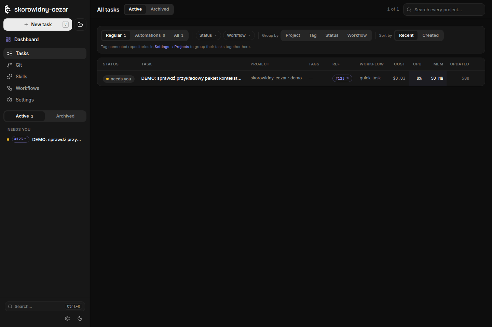
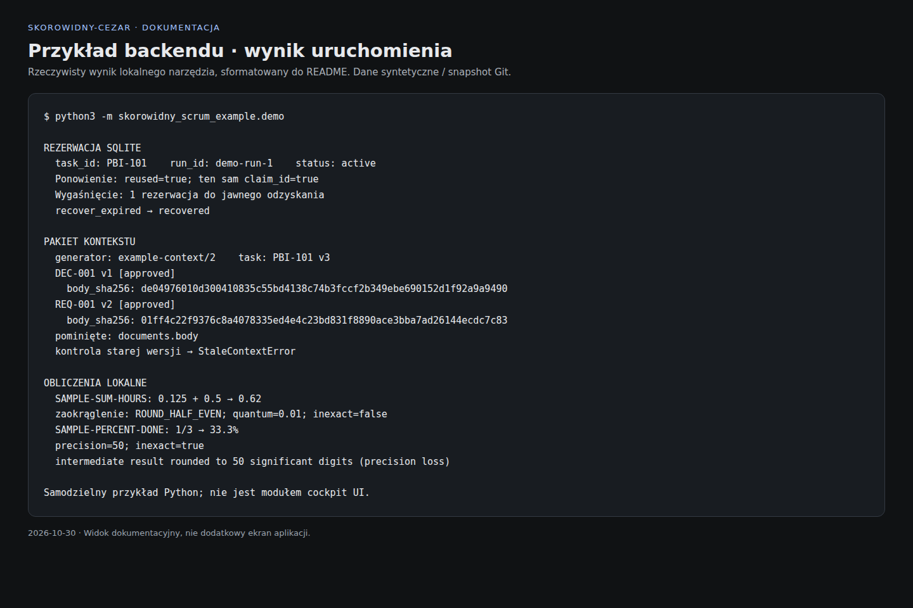
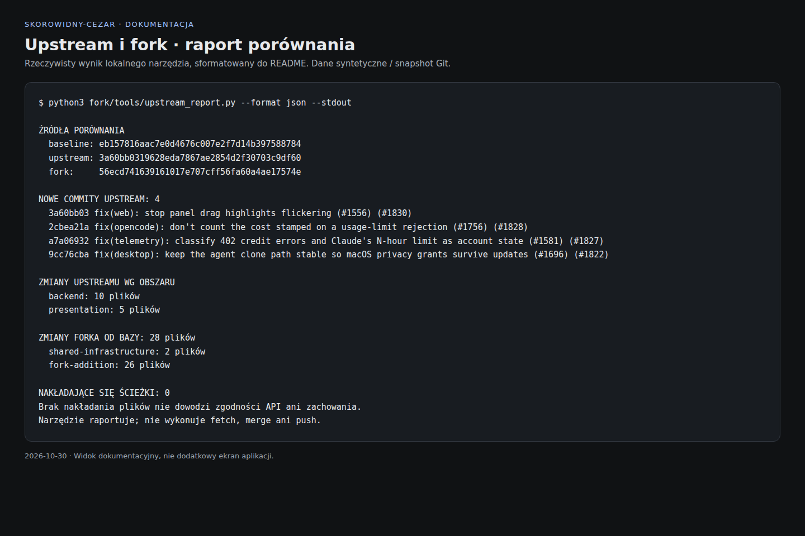

# skorowidny-cezar

Fork Cezara rozwijany w kierunku **Scruma wspieranego przez AI**: backlogu opisanego przez BA, refinementu wymagań, dokumentacji pobieranej na żądanie i pracy agentów na niezależnych branchach.

**Obecny etap: dokumentacja projektu, działające przykłady backendu i narzędzia utrzymania forka. Backlog Scrum i notatnik nie są jeszcze zintegrowane z cockpit UI.**

[Zakres projektu](docs/skorowidny-cezar/project-note.md) · [Koncepcja Scrum + AI](docs/skorowidny-cezar/scrum-concept.md) · [Zmiany i wyniki testów](docs/skorowidny-cezar/changes.md) · [Zgłoszenia](https://github.com/Skorowid/skorowidny-cezar/issues)

## Co wnosi ten fork

| Obszar | Gotowe w skorowidny-cezar | Status |
|---|---|---|
| Scrum i wymagania | Mapa odpowiedzialności, wydarzeń, artefaktów i zobowiązań; diagram procesu, przykład refinementu, DoR i otwarte decyzje | Dokumentacja koncepcji |
| Lokalny backlog | SQLite, zależności i atomowe rezerwacje pracy Sprintu; ponowienia, wygaśnięcie i jawne odzyskanie zadania | Samodzielny przykład Python |
| Kontekst agenta | Wersjonowane odwołania do dokumentów, streszczenia, hashe treści i wykrywanie nieaktualnego lub zmienionego pakietu | Samodzielny przykład Python |
| Obliczenia lokalne | `Decimal`, jawna reguła zaokrąglania i raportowanie utraty precyzji | Samodzielny przykład Python |
| Utrzymanie upstreamu | Zapisany commit bazowy, raport zmian backendu/UI/kontraktów i procedura przejmowania poprawek | Działające narzędzie i dokumentacja |
| Własny wygląd | Oddzielny kierunek rozwoju, z zachowaniem typowanych kontraktów backendu | Do zaprojektowania i implementacji |

Przykłady używają danych syntetycznych i biblioteki standardowej Pythona. Ich reguły są jawnie opisane jako przykładowe; nie stanowią zatwierdzonej specyfikacji produktu. Backendowe przykłady przygotował Claude, a przegląd, integrację i narzędzia utrzymania — Codex.

## Screeny aktualnego stanu

### Cockpit uruchomiony z checkoutu forka



Rzeczywisty lokalny podgląd w trybie `CEZ_DRY_RUN=1`, z osobną konfiguracją i danymi demo. Nazwa korzysta z istniejącej funkcji brandingu. **Układ i funkcje tego ekranu pochodzą z upstreamu**; nie przedstawia on nowego modułu Scrum.

### Działający przykład backendu



Wyniki rzeczywistego uruchomienia demonstracji, pokazane w widoku dokumentacyjnym. Ilustrują mechanizmy biblioteki Python; nie jest to ekran backlogu w aplikacji.

### Porównanie z oryginałem



Widok dokumentacyjny wygenerowany z rzeczywistego raportu JSON. Raport odnosi się do wskazanych SHA, więc liczby na screenie są snapshotem, a nie bieżącym licznikiem GitHuba. [Pochodzenie i odtworzenie screenów](docs/skorowidny-cezar/screenshots/README.md).

## Uruchom przykłady

Potrzebny jest Python 3; przykłady sprawdzono na Pythonie 3.14.4. Nie wymagają `pip`, kont modeli ani zewnętrznej bazy.

```bash
git clone --branch skorowidny/main https://github.com/Skorowid/skorowidny-cezar.git
cd skorowidny-cezar

# 54 testy przykładowego backendu
python3 -m unittest discover -s examples/skorowidny-scrum/backend -p 'test_*.py' -v

# Demo: JSON z rezerwacjami, kontekstem dokumentów i obliczeniami
cd examples/skorowidny-scrum/backend
python3 -m skorowidny_scrum_example.demo
```

[README backendu](examples/skorowidny-scrum/backend/README.md) zawiera kod użycia, przykładowe reguły, mapę fixtures i ograniczenia. To niezależna biblioteka demonstracyjna; nie jest importowana przez produkcyjny serwer Cezara.

## Uruchom lokalny cockpit z tego repozytorium

Potrzebne są Node.js 20+ i npm. Po powrocie do katalogu głównego repozytorium:

```bash
npm ci
npm run build

# Osobny profil i port; mock agenta, bez potrzeby logowania do modelu
CEZ_HOME="$(mktemp -d)" CEZ_DRY_RUN=1 CEZ_SKILLS_AUTO_UPDATE=0 CEZ_TELEMETRY=0 CEZ_NO_BANNER=1 \
  node packages/cezar/dist/index.js --repo . --port 4322 --no-open
```

Otwórz `http://127.0.0.1:4322`. Zakończ proces przez `Ctrl+C`. To podgląd checkoutu, nie instalacja ani podmiana działającej usługi. Dla rzeczywistej pracy agentów potrzebna jest konfiguracja obsługiwanego CLI; szczegóły odziedziczonych funkcji opisuje [referencja techniczna](docs/reference.md).

`npx cezar-run` pobiera oryginalną dystrybucję Cezara z npm — nie ten fork. Własny pakiet i kanał aktualizacji skorowidny-cezar nie są jeszcze przygotowane.

## Core, własny UI i aktualizacje

Domyślna gałąź rozwoju to **`skorowidny/main`**. Gałąź **`upstream-main`** wskazuje ostatnią w pełni przyjętą bazę oryginału, zapisaną również w [fork/upstream.json](fork/upstream.json). Odziedziczony `main` jest snapshotem z chwili utworzenia forka, a nie celem naszych zmian.

W obecnym przyroście produkcyjne pakiety backendu, klienta API, kontraktów, UI i desktopu są niezmienione względem zapisanej bazy. Dodatki znajdują się w `examples/skorowidny-scrum/`, `fork/` i `docs/skorowidny-cezar/`.

```bash
git remote add upstream https://github.com/open-mercato/cezar.git
gh repo set-default Skorowid/skorowidny-cezar
git fetch upstream --tags

# Uruchom z katalogu głównego; plik wynikowy musi jeszcze nie istnieć
python3 fork/tools/upstream_report.py --output /tmp/skorowidny-upstream-report.md

# Testy narzędzia porównania
python3 -m unittest discover -s fork/tools -p 'test_*.py' -v
```

Narzędzie pokazuje nadchodzące commity, kategorie zmian i nakładające się ścieżki. Nie wykonuje merge ani push. Poprawki backendu mogą wymagać zmian wspólnego kontraktu i klienta; sam brak konfliktu plików nie potwierdza zgodności.

[Porównaj własne zmiany ze wspólną bazą](https://github.com/Skorowid/skorowidny-cezar/compare/upstream-main...skorowidny%2Fmain) · [Procedura aktualizacji i niezależnego rozwoju UI](docs/skorowidny-cezar/upstream-maintenance.md)

## Następne przyrosty

Proponowany kierunek: karta PBI powiązana z runami, pytania i decyzje BA, notatnik UI, Product Backlog i Sprint Backlog oraz pobieranie pracy zgodnie z planem zespołu. Przed implementacją kolejnego fragmentu doprecyzujemy jego zachowanie i kryteria akceptacji. Pełna koncepcja jest w [dokumencie Scrum + AI](docs/skorowidny-cezar/scrum-concept.md).

## Weryfikacja

Pierwszy przyrost: **54 testy backendowych przykładów + 8 testów narzędzia porównania**, działające demo, typecheck, build, 48 testów core i 33 testy paczki CLI przeszły lokalnie. Pełny zestaw Vitest upstreamu nie był zielony — szczegółowe błędy i przekroczenie czasu są zapisane w [rejestrze zmian](docs/skorowidny-cezar/changes.md).

GitHub Actions pozostają wyłączone do osobnej konfiguracji. Obecność pliku workflow nie oznacza wykonanego CI ani opublikowania paczki npm.

## Pochodzenie

Projekt bazuje na [open-mercato/cezar](https://github.com/open-mercato/cezar). Oryginał dostarcza cockpit, CLI, uruchamianie agentów, worktree, workflow, integracje trackerów i pozostałą infrastrukturę. Nasze zmiany i ich status opisano wyżej oraz w [rejestrze zmian forka](docs/skorowidny-cezar/changes.md).

[Oryginalne README z zapisanej bazy](https://github.com/open-mercato/cezar/blob/eb157816aac7e0d4676c007e2f7d14b397588784/README.md) · [LICENSE](LICENSE)
