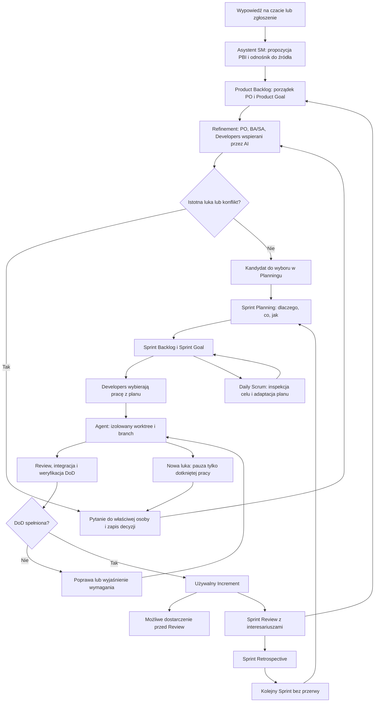

# Cezar: Scrum wspierany przez agentów AI

> English note: this is the early working concept and is kept as history. What is built and approved is in [scrum-coordinator.md](scrum-coordinator.md), [scrum-chat.md](scrum-chat.md) and [scrum-integration.md](scrum-integration.md).

Data: 2026-10-30. Wersja: 0.2. Status: robocza koncepcja do dalszego refinementu.

Źródło potrzeby: rozmowa z użytkownikiem — rozbudowa Cezara o backlog, pracę nad wymaganiami, notatnik w UI i niezależne wykonania agentów. Dodatkowe wymaganie: uwzględnić wszystkie elementy Scruma. Dokument zapisuje pomysł; nie zatwierdza szczegółów zachowania przyszłego systemu. Nie zatwierdza wdrożenia modułu Scrum. Fork i przykłady opisuje [notatka projektowa](project-note.md).

## 1. Kierunek

Propozycja: Cezar jako przestrzeń pracy zespołu prowadzącego produkt w Scrumie, z agentami wspomagającymi analizę, implementację, testowanie i dokumentację. Backlog opisuje potrzebną zmianę produktu. Uruchomienie agenta jest jedną z prób wykonania pracy, a nie samym elementem backlogu.

Przykład: PBI-42 może wymagać refinementu, implementacji, poprawki po review i ponownej weryfikacji. To nadal jeden element produktu, powiązany z kilkoma uruchomieniami i dowodami wykonania.

Ważna granica: Scrum Guide opisuje zespół ludzi. Agent o nazwie „Scrum Master” może wspierać facylitację, lecz sama symulacja rozmów modeli nie ustanawia odpowiedzialności ani rzeczywistej współpracy z interesariuszami. Proponowany model to ludzie odpowiedzialni za produkt i proces, wspierani przez narzędzia AI. Wariant całkowicie autonomiczny byłby adaptacją inspirowaną Scrumem i wymaga osobnej decyzji.

## 2. Źródła i rozróżnienie reguł

Podstawą ram Scruma jest załączony `pasted-2.pdf`: Scrum Guide, listopad 2020, Ken Schwaber i Jeff Sutherland. Publiczny odpowiednik: [Scrum Guide](https://scrumguides.org/scrum-guide.html), [polskie tłumaczenie](https://scrumguides.org/docs/scrumguide/v2020/2020-Scrum-Guide-Polish.pdf).

Materiały pomocnicze przekazane w rozmowie obejmowały Scrum Guide 2020, materiały edukacyjne oraz słownik i zestawienie odpowiedzialności. Oryginalnych załączników ani danych sesji nie publikujemy w repozytorium. Zasady ram opieramy na publicznym Scrum Guide wskazanym powyżej.

Oznaczenia w dokumencie:

- **Scrum**: element ram opisany w załączonym Scrum Guide.
- **Ustalenie użytkownika**: kierunek zamówiony w rozmowie, bez domniemania szczegółowej akceptacji rozwiązania.
- **Propozycja**: rozwiązanie projektowe do omówienia przed implementacją.

„Wszystkie praktyki” interpretujemy jako pełny zakres Scrum Guide oraz jawne rozpatrzenie praktyk uzupełniających. Nie istnieje zamknięta lista wszystkich technik stosowanych przez wszystkie zespoły. Story points, Jira, user stories, DoR, tablica i wykresy nie stają się obowiązkami Scruma.

### Różnice w materiałach wymagające ostrożności

- Materiały edukacyjne opisują refinement jako opcjonalny; Guide opisuje go jako trwającą aktywność doprecyzowania, wykonywaną w miarę potrzeby. Nie ustanawiamy obowiązkowego szóstego wydarzenia ani obowiązkowego osobnego spotkania.
- Słownik XLSX mówi o Daily każdego dnia Sprintu; Guide precyzuje każdy dzień roboczy. Kalendarz pracy ludzi i całodobowe wykonywanie zadań przez serwer wymagają uzgodnienia.
- XLSX zawiera „Scrum board”, velocity i dokumentację przy Developers. Traktujemy to jako pomocnicze zestawienie, a nie dodatkowe formalne artefakty lub nakazane metryki.
- Niektóre opisy Review z materiałów edukacyjnych obejmują tematykę nakładającą się na Retro. W projekcie zachowujemy osobne cele tych wydarzeń.

## 3. Pełna mapa Scruma i propozycja obsługi w Cezarze

### Fundamenty i wartości

| Element Scruma | Propozycja wsparcia |
|---|---|
| Empiryzm | Wnioski z działającego Incrementu, wyników testów, informacji od użytkowników i obserwowanych ograniczeń |
| Lean | Pobieranie potrzebnego kontekstu, ograniczanie zbędnych uruchomień i oczekiwania |
| Przejrzystość | Widoczne cele, backlogi, decyzje, blokady, stan jakości i pochodzenie danych |
| Inspekcja | Wydarzenia, sprawdzalne dowody realizacji i ocena postępu względem celów |
| Adaptacja | Zmiana planu i backlogu po uzyskaniu nowej wiedzy, z zachowaniem odpowiedzialności |
| Zaangażowanie | Praca na rzecz celu i wspieranie zespołu, zamiast obietnicy ukończenia dowolnej liczby ticketów |
| Skupienie | Sprint Goal widoczny przy wyborze kolejnej pracy |
| Otwartość | Agent ujawnia niepewność, błędy i niespełnione kryteria |
| Szacunek | Wkład ludzi i agentów można prześledzić; uwagi dotyczą pracy i dowodów |
| Odwaga | Zgłaszanie sprzeczności i zakwestionowanie pozornego „Done” |

### Odpowiedzialności i współpraca

| Odpowiedzialność | Scrum | Proponowane wsparcie AI |
|---|---|---|
| Product Owner | Jedna osoba odpowiedzialna za wartość produktu, Product Goal, kolejność i przejrzystość Product Backlogu; może delegować pracę, zachowuje odpowiedzialność | Asystent porządkuje propozycje i pokazuje skutki decyzji; nie przejmuje samodzielnie decyzji produktowych |
| Scrum Master | Skuteczność zespołu, rozumienie Scruma, facylitacja i usuwanie przeszkód | Asystent wychwytuje ustalenia z czatu, prowadzi listę przeszkód i przygotowuje wydarzenia; nie jest kierownikiem przydzielającym pracę |
| Developers | Plan Sprintu, jakość zgodna z DoD, codzienna adaptacja i wzajemna odpowiedzialność | Agenci pomagają badać, szacować, implementować, testować i weryfikować; sposób wykonania pozostaje w domenie Developers |
| BA/SA | Nie jest dodatkową formalną odpowiedzialnością Scrum Guide | Specjalizacja wspierająca PO i Developers; w tym projekcie wskazany analityk potwierdza reguły biznesowe i kontrakty |
| Interesariusze | Dostarczają wiedzy i feedbacku, współpracują przy inspekcji produktu | UI zbiera pytania, decyzje i feedback; model nie zastępuje ich odpowiedzi |

Scrum Team jest interdyscyplinarny, samozarządzający i bez wewnętrznej hierarchii; zwykle liczy najwyżej około 10 osób. Liczba procesów agentów nie jest liczbą członków zespołu. Specjalizacje agentów nie tworzą oddzielnych podzespołów analizy, kodowania i QA z przekazywaniem odpowiedzialności przez bramki.

Wiele zespołów przy jednym produkcie współdzieli Product Goal, Product Backlog, Product Ownera i Definition of Done. Niezależne produkty mogą mieć niezależne cele i backlogi. Nie łączymy przypadkowych repozytoriów w jeden Sprint tylko dlatego, że korzystają z tego samego serwera.

### Wydarzenia

| Wydarzenie | Zasady Scruma | Propozycja obsługi |
|---|---|---|
| Sprint | Stała długość do miesiąca; zawiera pozostałe wydarzenia; kolejny zaczyna się bez przerwy | Cel, ramy czasowe, plan, Incrementy i historia adaptacji w jednym widoku |
| Sprint Planning | Cały Scrum Team ustala dlaczego, co i jak; Developers wybierają pracę w rozmowie z PO i tworzą plan; Sprint Goal powstaje przed końcem Planningu | Agent przygotowuje kandydatów i zależności, ludzie współtworzą cel i plan; nie ma automatycznego upychania zadań do pełnego CPU |
| Daily Scrum | 15 minut, dla Developers, o tej samej porze i miejscu każdego dnia roboczego; inspekcja postępu do Sprint Goal i adaptacja planu | Zwięzłe fakty przed wydarzeniem, następnie rzeczywista decyzja o planie; nie raport statusu do SM |
| Sprint Review | Scrum Team i interesariusze wspólnie badają rezultat, zmiany otoczenia i dalszy kierunek | Działający produkt, dowody, feedback i aktualizacja backlogu; nie samo demo ani bramka wydania |
| Sprint Retrospective | Scrum Team analizuje ludzi, współpracę, proces, narzędzia i DoD; wybiera usprawnienia; kończy Sprint | Fakty o przeszkodach, kosztach i błędach oraz konkretna zmiana procesu z terminem sprawdzenia skutku |

Limity dla miesięcznego Sprintu: Planning do 8 godzin, Review do 4 godzin, Retro do 3 godzin. Dla krótszych Sprintów wydarzenia zwykle są krótsze; Daily zachowuje 15 minut. Nie trzeba wypełniać całego timeboxu. Długość Sprintu, kalendarz i godziny wydarzeń pozostają do ustalenia; dokument nie uruchamia harmonogramów.

Podczas Sprintu nie obniża się jakości ani nie zmienia pracy w sposób zagrażający Sprint Goal. Zakres może być doprecyzowany i renegocjowany przez Developers z PO. Plan jest żywy. Gdy cel staje się nieaktualny, wyłącznie PO może anulować Sprint.

Refinement trwa w miarę potrzeby, również w Sprincie. Nie wymaga zakończenia analizy całego produktu przed pierwszą implementacją. Developers odpowiadają za sizing. Prognoza zakresu uwzględnia doświadczenie, pojemność i DoD; nie jest zobowiązaniem do ukończenia każdej pozycji.

### Artefakty i zobowiązania

| Artefakt | Zobowiązanie | Propozycja reprezentacji |
|---|---|---|
| Product Backlog | Product Goal | Jedna uporządkowana lista potrzeb produktu; jawny aktualny cel, do którego prowadzą elementy |
| Sprint Backlog | Sprint Goal | Cel, wybrane PBI i aktualizowany plan Developers |
| Increment | Definition of Done | Używalny, zweryfikowany rezultat współdziałający z wcześniejszym produktem; dowody spełnienia wersji DoD |

Przed podjęciem kolejnego Product Goal bieżący należy osiągnąć albo porzucić. W Sprincie może powstać wiele Incrementów; można dostarczać je przed Review. Praca niespełniająca DoD nie jest Incrementem: nie wydajemy jej ani nie prezentujemy jako ukończonej. Na Review można transparentnie omówić nieukończenie, ale nie demonstrować takiej pracy jako gotowego rezultatu. Niedokończone elementy wracają do rozważenia w Product Backlogu, bez automatycznego przenoszenia jako obietnicy następnego Sprintu.

DoD uwzględnia co najmniej obowiązujące standardy organizacji; bez nich definiuje ją Scrum Team. Akceptacja konkretnej story i DoD to różne rzeczy. Sam test, commit, zamknięty run czy zgoda modelu nie dowodzą spełnienia DoD. Dla oprogramowania propozycja DoD może obejmować integrację, testy właściwe dla zmiany, review i aktualizację potrzebnej dokumentacji; konkretna lista wymaga uzgodnienia.

## 4. Proponowany przepływ od czatu do Incrementu



Diagram pokazuje zależności, a nie fazy Waterfall. Refinement, weryfikacja i adaptacja powtarzają się; pierwsza ukończona mała zmiana może wejść do Incrementu, gdy inne PBI nadal są opracowywane. Daily działa przez Sprint, a nie tylko raz przy jego rozpoczęciu. Niezależna gotowa praca może być kontynuowana podczas wyjaśniania innego elementu.

### Przykładowy refinement — wyłącznie ilustracja

1. Użytkownik: „Chcę eksport backlogu do arkusza”. Asystent SM zapisuje propozycję `PBI-42`, źródłową wiadomość i brak decyzji o zakresie.
2. Asystent BA pyta: „BLOCKING, PBI-42: które pola i pozycje ma obejmować eksport — aktualny filtr czy całość? Czy wymagane są XLSX, czy wystarczy CSV?”. Nie wybiera odpowiedzi za użytkownika.
3. Developer wskazuje zależność: istniejące reguły dostępu i format dat. Tester wskazuje scenariusze pustego wyniku, znaków narodowych i braku uprawnień.
4. Upoważniona osoba odpowiada. BA zapisuje reguły i kryteria; PO ustala miejsce w backlogu; Developers oceniają rozmiar i możliwość ukończenia w jednym Sprincie.
5. Ocena DoR jest powtarzana. Dopiero brak blokujących luk pozwala rozpocząć dotkniętą implementację. Zapis pytania nie oznacza odpowiedzi.
6. Developers wybierają PBI w Planningu, jeżeli wspiera wspólnie uzgodniony Sprint Goal. Agent otrzymuje zadanie i niezbędny kontekst, bez całego backlogu.
7. Narzędzie generuje plik; automat sprawdza strukturę i przykładowe dane. AI ocenia pozostałe aspekty. Weryfikacja obejmuje również integrację z resztą produktu i uzgodnioną DoD.

Wymiana agentów ma mieć cel: wykryć konkretną lukę albo podjąć uprawnioną decyzję techniczną. Propozycja limitu sesji refinementu i liczby rund pozostaje do uzgodnienia. Nierozwiązane pytanie trafia do człowieka; agenci nie dyskutują bez końca.

## 5. Backlog, zadania i wykonania

Proponowane obiekty — szkic, nie zatwierdzony model danych:

- **Produkt**: granice, interesariusze, PO, Product Goal, repozytoria.
- **PBI**: ID, potrzeba i wartość, kolejność, opis, kryteria, powiązane decyzje, zależności i pytania. User story jest możliwym formatem, nie wymogiem dla każdej pozycji.
- **Sprint**: ramy czasowe, Sprint Goal, wybrane PBI, plan, wyniki wydarzeń.
- **Zadanie wykonawcze**: część planu Developers, zakres techniczny i powiązanie z PBI.
- **Run agenta**: próba wykonania, branch/worktree, wejściowa wersja specyfikacji, rezultat, koszt i dowody.
- **Decyzja, pytanie, notatka**: osobny status, autor/rola, źródło, data i odnośniki.
- **Increment i DoD**: zweryfikowany rezultat oraz zastosowane kryteria jakości.

Trzy osobne wymiary statusu zapobiegają myleniu gotowości ze skutecznym uruchomieniem:

| Wymiar | Propozycja |
|---|---|
| DoR według instrukcji użytkownika | READY / NEEDS CLARIFICATION / BLOCKED / CHANGE REQUEST — dokładnie jeden status główny |
| Realizacja PBI | Np. otwarte / w pracy / weryfikacja / ukończone; nazwy i przejścia do ustalenia |
| Run | Status wykonania obsługiwany przez Cezara; awaria runu nie usuwa story ani jej historii |

DoR jest dodatkową polityką projektu, nie formalnym artefaktem Scruma. Ocena dotyczy pojedynczego przyrostu: źródła i celu, zachowania, danych, błędów, zależności, jakości, kryteriów, zgodności i uprawnień. Wymagana jest tylko mająca zastosowanie szczegółowość. Zmiana zatwierdzonego baseline oznacza CHANGE REQUEST, krytyczny konflikt lub brak zależności BLOCKED, inne rozstrzygalne braki NEEDS CLARIFICATION. Odpowiedź wymaga ponownej oceny, nie automatycznego READY.

Proponowany pakiet startowy runu: PBI i wersja, Product Goal i Sprint Goal, właściwe wymagania i decyzje, kryteria, DoD, zakres plików, kontrakty zależności, odnośniki do dokumentów i sposób weryfikacji. Model nie musi czytać całej historii produktu.

### Pobieranie pracy

Zwykły scheduler wyszukuje kandydatów z aktualnego planu, sprawdza zależności, dostępne zasoby i zajęty zakres. Developers decydują o planie i sposobie pracy; reguły automatycznego pobierania muszą odzwierciedlać ich uzgodnienia. Scrum Master nie rozdziela odgórnie zadań.

Propozycja techniczna: atomowa rezerwacja zadania z identyfikatorem wykonania i czasem ważności. Ponowione zdarzenie nie powinno tworzyć kolejnej implementacji tego samego zadania. Utrata procesu prowadzi do jawnego odzyskania rezerwacji i weryfikacji pozostawionych zmian, a nie cichego uruchomienia konkurencyjnego autora.

Niezależne zakresy mogą pracować równolegle w osobnych worktree. Wspólne kontrakty należy najpierw uzgodnić. Integracja jest częsta i weryfikowana po każdym przyjętym scaleniu; izolowane branche nie dowodzą powstania wspólnego Incrementu. Uprawnienia do scalania i publikacji są osobną decyzją; obecny Guard pozostaje wiążący.

## 6. UI i notatnik

Proponowane widoki:

1. **Produkt** — Product Goal, PO, granice i miary wartości.
2. **Product Backlog** — uporządkowane PBI, źródła, gotowość, pytania, zależności i decyzje.
3. **Sprint** — Sprint Goal, Sprint Backlog, plan i jego zmiany, Incrementy, wydarzenia.
4. **PBI** — opis BA, kryteria, dyskusja, dokumenty, runy, branche/PR i dowody jakości.
5. **Notatnik** — notatki produktu, PBI lub wydarzenia, ze statusem szkic / propozycja / decyzja potwierdzona / zastąpiona.
6. **Proces** — diagram, aktywny krok, blokady, właściciel decyzji i pochodzenie zmiany.
7. **Przeszkody i usprawnienia** — działania SM i wyniki Retro, powiązane z pracą produktu, gdy to właściwe.

Czat tworzy propozycje PBI, pytań i decyzji. Sam zapis wiadomości ani wygenerowane streszczenie nie zatwierdza wymagania. UI powinno umożliwiać porównanie propozycji ze źródłem oraz identyfikować rolę uprawnioną do rozstrzygnięcia. Granica automatycznych zapisów pozostaje do uzgodnienia.

## 7. Odciążanie AI zwykłym oprogramowaniem

Propozycja: lokalne narzędzia na istniejącym serwerze, wywoływane przez CLI, małe API lub adapter MCP. Nie trzeba uruchamiać osobnej usługi dla każdej funkcji. Brak opłat za tokeny obliczeniowe nie oznacza braku kosztów serwera, utrzymania ani tokenów potrzebnych na odczyt wyników przez model.

| Praca | Narzędzie | Co przekazać modelowi |
|---|---|---|
| Sumy, procenty, daty, zaokrąglenia | Python: `sum`, `decimal`, `datetime`; dla równań SymPy | Wynik, wejście, wersję reguły i ewentualne ostrzeżenie |
| Filtrowanie i agregowanie danych | SQLite; DuckDB przy analizie plików tabelarycznych | Mały wynik zapytania zamiast całego pliku lub tabeli |
| Wyszukiwanie dokumentów | Indeks metadanych + SQLite FTS5; `rg` w repozytorium | Trafne fragmenty z ID, statusem, wersją i źródłem |
| Odczyt/zapis XLSX | openpyxl | Wybrane komórki, wyniki kontroli i odnośnik do pliku |
| Przeliczanie arkuszy | Opcjonalny worker LibreOffice Calc w trybie headless | Obliczone wartości i raport zgodności dla obsługiwanych formuł |
| Walidacja struktury PBI i kontraktów | JSON Schema, np. python-jsonschema | Konkretne brakujące pola i błędy walidacji |
| Wykrywanie zmian i nieaktualnych kontekstów | Git diff, hashe treści, graf zależności | Zmienione sekcje oraz lista dotkniętych PBI |
| Kontrola kodu | Istniejące testy, lintery, type checker i build projektu | Podsumowanie i wskazane błędy; pełny log dostępny na żądanie |
| Kolejka, zajętość, raporty przepływu | Zapytania SQL i deterministyczny scheduler | Następne dopuszczalne zadanie lub precyzyjny powód blokady |

`decimal` udostępnia kontrolowaną arytmetykę dziesiętną i zaokrąglenia; nie wybiera biznesowej reguły zaokrąglania. openpyxl odczytuje i zapisuje arkusze, ale nie jest silnikiem przeliczania formuł. Wynik zapisany w cache pliku może być nieaktualny. Zgodność LibreOffice z używanymi formułami należy sprawdzić na przykładach, zamiast zakładać pełną zgodność z Excelem.

Walidator sprawdzi obecność kryteriów, lecz nie rozstrzygnie, czy opisują właściwą potrzebę. SQL policzy wynik, lecz wymaga poprawnej definicji danych i reguł. AI nadal pomaga interpretować niejednoznaczność i projektować rozwiązanie; człowiek potwierdza decyzje biznesowe.

Proponowane interfejsy koncepcyjne: `get_task_context(id, version)`, `search_docs(query, module, status)`, `get_doc_section(id, section, version)`, `validate_item(id)`, `calculate(rule_id, inputs)`, `run_checks(task_id)`. Nie są istniejącymi endpointami Cezara. Wyniki powinny mieć kontrolowany rozmiar, jawne oznaczenie pominięć i możliwość doczytania szczegółów. Dostęp do danych powinien wynikać z uprawnień zadania, z ograniczonymi kontami baz danych i bez przekazywania sekretów w promptach.

Źródła techniczne: [SQLite FTS5](https://www.sqlite.org/fts5.html), [DuckDB — dane CSV](https://duckdb.org/docs/stable/data/csv/overview), [Python decimal](https://docs.python.org/3/library/decimal.html), [SymPy](https://docs.sympy.org/latest/index.html), [openpyxl](https://openpyxl.readthedocs.io/en/stable/), [LibreOffice — parametry uruchomienia](https://help.libreoffice.org/latest/en-US/text/shared/guide/start_parameters.html), [python-jsonschema](https://python-jsonschema.readthedocs.io/en/stable/).

## 8. Dokumentacja hierarchiczna i oszczędzanie kontekstu

Propozycja struktury w repozytorium produktu:

```text
docs/
  INDEX.md
  product/
    goal.md
    glossary.md
  process/
    definition-of-done.md
    working-agreements.md
  modules/
    backlog/
      INDEX.md
      requirements/
        REQ-042-export.md
      contracts/
        export-format.md
    scheduling/
      INDEX.md
      requirements/
  decisions/
    DEC-001-source-of-truth.md
  sprints/
    SPRINT-001/
      goal-and-plan.md
      review.md
      retrospective.md
```

Każdy `INDEX.md` zawiera krótkie opisy i odnośniki. PBI i dokument mają trwałe ID niezależne od ścieżki. Nazwa folderu pomaga wybrać moduł, ale nie wystarcza: indeks zawiera też aliasy, zależności między modułami i powiązania z wymaganiami. Wyszukiwanie obejmuje metadane i treść, aby nie pomijać reguł schowanych pod inną nazwą.

Przykładowy nagłówek dokumentu:

```yaml
---
id: REQ-042
title: Eksport backlogu
summary: Zakres eksportu i format danych; projekt do wyjaśnienia.
module: backlog
status: draft
version: 1
owner: do-wskazania
approved_by: null
source_ids: [PBI-42]
depends_on: []
supersedes: []
updated_at: 2026-10-30
---
```

Proponowana kolejność odczytu: karta zadania → właściwy indeks modułu → wskazane wymagania i decyzje → potrzebne kontrakty → dodatkowy kontekst na żądanie. Kontekst zawiera także reguły przekrojowe i DoD; oszczędność nie może usuwać ograniczeń wpływających na zadanie.

Indeks i streszczenia generujemy przy zmianie, nie przy każdym uruchomieniu. Klucz cache obejmuje wersje dokumentów, uprawnienia i wersję generatora. Zmiana zatwierdzonej reguły unieważnia powiązane pakiety kontekstu. Stare zatwierdzenie zachowuje historię, ale nie zatwierdza nowej treści.

Kompaktowość uzyskujemy przez brak duplikacji, pola strukturalne, fragmenty i różnice wersji. Nie przez usuwanie wyjątków albo kompresowanie wymagań w nieczytelne skróty. Pełny dokument pozostaje dostępny. UI może wyświetlać notatki z tych samych danych; nie tworzymy drugiej, rozchodzącej się specyfikacji.

## 9. Jira, GitHub/GitLab i źródło prawdy

Cezar już dokumentuje integracje trackerów Jira/Linear oraz wykonywanie workflow i izolowanych zadań. To punkt wyjścia, nie dowód istnienia kompletnego modułu Scrum. Przed forkiem potrzebny jest przegląd istniejących punktów rozszerzeń i sposobu aktualizacji. Źródło: [dokumentacja Cezara](https://github.com/open-mercato/cezar/blob/main/docs/reference.md).

Propozycje wariantów:

| Wariant | Źródło prawdy | Konsekwencja |
|---|---|---|
| Jira jako backlog | Jira dla PBI i uzgodnionych danych planowania; Cezar dla runów | Mniej własnego UI do zarządzania pracą; wymagany kontrakt synchronizacji |
| Backlog w Cezarze | Baza Cezara dla PBI i planu; tracker opcjonalny | Pełna kontrola UX; więcej implementacji i utrzymania |
| Pliki w Git na pilotaż | Wersjonowane karty PBI i dokumentacja | Prosta inspekcja zmian; współbieżna edycja i porządkowanie backlogu wymagają obsługi |

Przy integracji nie utrzymujemy dwóch niezależnie edytowanych kopii tych samych pól. Trzeba ustalić właściciela każdego pola, mapowanie statusów, konflikty, retry, usunięcia i identyfikację duplikatów. Powiadomienie z trackera może dostarczyć ID i wersję story; adapter pobiera jej treść oraz jawne zależności. Nie pobiera całego backlogu do promptu.

GitHub lub GitLab może pozostać miejscem kodu, PR/MR i CI. Wybór hostingu nie rozwiązuje odpowiedzialności za backlog ani dokumentację. Nie zakładamy bezpłatności wybranego planu Jira lub hostingu; warunki należy sprawdzić przed wyborem. Lokalne narzędzia z sekcji 7 są propozycją odciążenia obliczeń bez dodatkowej usługi SaaS.

## 10. Praktyki uzupełniające — jawnie opcjonalne

| Praktyka | Propozycja zastosowania |
|---|---|
| User stories i kryteria akceptacji | Gdy pomagają opisać wartość i wynik; bug lub badanie może mieć inny format |
| DoR | Stosować per slice zgodnie z instrukcjami użytkownika, bez wymagania pełnego BRD/FRD całego produktu |
| Story points, planning poker, sizing względny | Developers wybierają technikę; AI może przedstawiać przesłanki, nie narzuca skali |
| Velocity | Opcjonalna prognoza zespołu; nie ranking agentów ani cel maksymalizacji |
| Burn-down, burn-up, cumulative flow | Liczone z historii zdarzeń; nie zastępują inspekcji wartości i celu |
| WIP i pull | Uzgodnione ograniczenie rozgrzebanej pracy; nie wymuszać pełnego wykorzystania CPU |
| Review kodu, CI, testy, częsta integracja | Techniki wspierające uzgodnioną jakość Incrementu |
| Spike i eksperyment | Krótkie badanie konkretnej niepewności, z pytaniem i wynikiem, bez pozornej gwarancji funkcji |
| Release planning | Prognoza oparta na danych i ryzyku, aktualizowana po obserwacjach |
| Rejestr długu technicznego | Widoczna praca wpływająca na produkt; rozważana w backlogu |
| Action items z Retro | Konkretne usprawnienia, właściciele i sprawdzenie efektu |

## 11. Kierunek techniczny i kolejność rozwoju

Proponowany podział odpowiedzialności modułów: model produktu i backlogu; planowanie Sprintu; intake/refinement; kontekst i dokumentacja; wykonania Cezara; adapter trackera; dowody jakości. Granice logiczne nie oznaczają osobnych mikroserwisów. Fork powinien zachować języki i konwencje istniejącego Cezara; lokalne pomocnicze narzędzia można pisać w Pythonie.

Proponowana kolejność małych przyrostów do dalszego refinementu:

1. Karta PBI, źródło, pytania i notatki z UI, powiązane z istniejącym runem.
2. Product Goal, uporządkowany backlog, DoR i zapis decyzji.
3. Sprint Goal, Sprint Backlog, wydarzenia i DoD, z pełną widocznością wyników.
4. Pobieranie pracy z planu, rezerwacje i niezależne worktree.
5. Indeks kontekstu oraz narzędzia lokalnego wyszukiwania, obliczeń i walidacji.
6. Wybrana integracja trackera i dalsze usprawnienia wynikające z Retro.

Każdy etap wymaga własnej oceny DoR przed implementacją. Częściowa funkcjonalność aplikacji może wspierać zespół używający pozostałych elementów Scruma poza aplikacją; nie nazywamy samej kolejki tasków kompletnym Scrumem.

Na obecnym serwerze zaobserwowano 20 dostępnych CPU, około 40 GiB RAM i globalne `maxParallel=3`. Są to obserwacje z tej sesji, nie gwarantowana pojemność. Pilotaż kilku niezależnych zadań powinien mierzyć czas ukończenia, limity dostawców, szczyt RAM i konflikty integracji. Więcej procesów nie oznacza automatycznie więcej wartości.

## 12. Ocena gotowości następnego kroku

Zapis koncepcji jest **READY**: użytkownik zamówił roboczy Markdown i uzupełnienie o Scrum. Przygotowanie forka i izolowanych przykładów zostało następnie zamówione osobno; nie oznacza zatwierdzenia produkcyjnego modelu danych.

| ID i zakres przyszłej implementacji | Status główny | Luka / wymagane rozstrzygnięcie | Wpływ i właściciel |
|---|---|---|---|
| CSM-01 Model produktu i odpowiedzialności | NEEDS CLARIFICATION | Granice produktu, PO, SM i upoważniony analityk | Użytkownik wskazuje osoby; bez tego nie projektujemy uprawnień decyzyjnych |
| CSM-02 Backlog i tracker | NEEDS CLARIFICATION | Jira, Cezar czy Git; źródło prawdy i właściciele pól | Użytkownik/PO; wpływa na model i synchronizację |
| CSM-03 Sprint i wydarzenia | NEEDS CLARIFICATION | Długość Sprintu, kalendarz, udział ludzi i tryb obsługi wydarzeń | Scrum Team; wpływa na planowanie i UI |
| CSM-04 Intake, BA i DoR | NEEDS CLARIFICATION | Co agent zapisuje sam, a co wymaga potwierdzenia; format akceptacji | PO i upoważniony BA/SA; wpływa na workflow i audit |
| CSM-05 Wykonanie i DoD | NEEDS CLARIFICATION | Repozytoria, zależności, kryteria jakości, integracja, merge i publikacja | Developers oraz właściciel repo; brak zgody na automatyczne publikowanie |
| CSM-06 Dokumentacja i dane | NEEDS CLARIFICATION | Źródła, uprawnienia, formaty, aktualizacja indeksu, dane przekazywane modelom | Właściciel danych i BA/SA; wpływa na kontekst i adaptery |
| CSM-07 Fork Cezara | NEEDS CLARIFICATION | Repozytorium docelowe i sposób utrzymania zgodności z upstream | Użytkownik i opiekun techniczny; sposób aktualizacji opisano w notatce projektowej |

To kwestie blokujące odpowiednią implementację, ale nie zapis pomysłu. Nie wymagają odpowiedzi wszystkich naraz. Przed wybranym małym przyrostem należy zadać konkretne pytania tylko o jego zależności, np. „CSM-02, BLOCKING: które źródło jest edytowalną wersją PBI — Jira czy Cezar?”.

## 13. Jak sprawdzić, czy pomysł działa

Proponowane scenariusze pilotażu, do uzgodnienia jako kryteria akceptacji:

- Z czatu powstaje propozycja PBI ze źródłem; nie staje się sama zatwierdzonym wymaganiem.
- Luka biznesowa blokuje tylko zależną implementację; niezależna praca trwa.
- Zadanie dostaje mały, aktualny pakiet kontekstu z odnośnikami, DoD i regułami przekrojowymi.
- Dwa równoczesne pobrania nie uruchamiają tej samej pracy dwukrotnie; restart nie gubi rezerwacji bez śladu.
- Zmiana wymagania unieważnia stary kontekst i wymaga reassessmentu dotkniętej pracy.
- Ukończony run niespełniający DoD nie oznacza ukończonego PBI ani Incrementu.
- Niezależne branche po integracji przechodzą wspólne sprawdzenia, nie tylko izolowane testy.
- Review daje feedback produktowy; Retro prowadzi do sprawdzalnego usprawnienia.
- PBI niedokończone na koniec Sprintu wraca do backlogu do ponownego rozważenia.
- Obliczenia i wyszukiwanie wykonują narzędzia, a model dostaje zwięzłe wyniki z pochodzeniem.

Porównanie z obecnym sposobem pracy powinno objąć tokeny na ukończone PBI, czas oczekiwania na decyzję, czas dostarczenia wartości, poprawki po review, awarie, koszty i ocenę użytkownika. Nie ustalamy procentowej oszczędności bez pomiaru. Liczba wiadomości między agentami, zajęte CPU i liczba zamkniętych ticketów nie są samodzielnymi miarami sukcesu produktu.
